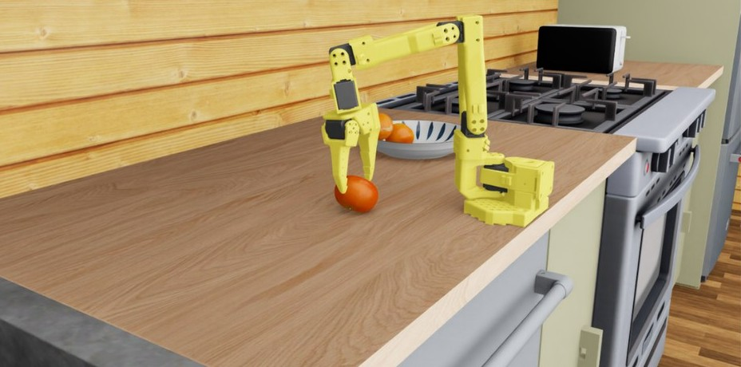
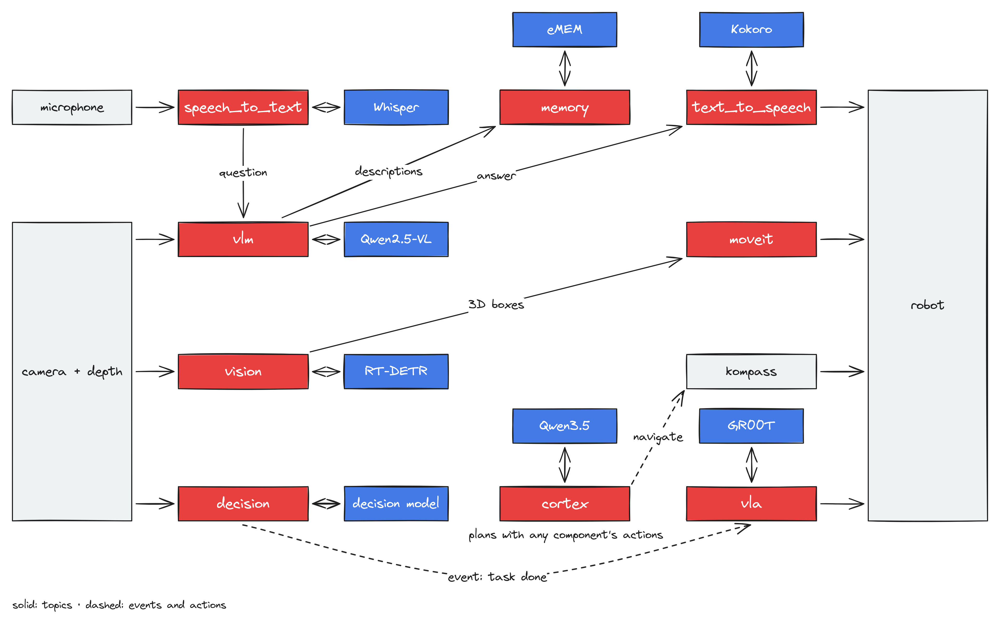

<div align="center">

<picture>
  <source media="(prefers-color-scheme: dark)" srcset="docs/_static/EMBODIED_AGENTS_DARK.png">
  <source media="(prefers-color-scheme: light)" srcset="docs/_static/EMBODIED_AGENTS_LIGHT.png">
  
</picture>

<br/>

**The production-grade framework for deploying Physical AI**

[](LICENSE)
[](https://emos.automatikarobotics.com/getting-started/installation.html)
[](https://discord.gg/B9ZU6qjzND)

[**Documentation**](https://emos.automatikarobotics.com) · [**Developer Docs**](https://automatika-robotics.github.io/embodied-agents/) · [**Recipes**](https://emos.automatikarobotics.com/recipes/overview.html) · [**Discord**](https://discord.gg/B9ZU6qjzND)

</div>

---

<p align="center">
  
  <br>
  <sub>An SO-101 arm picks oranges in Isaac Sim with a GR00T N1.7 policy, run by the VLA component. An event stops the policy when a VLM watching the camera judges the task done (<a href="https://emos.automatikarobotics.com/recipes/planning-and-manipulation/event-driven-vla.html">recipe</a>).</sub>
</p>

**EmbodiedAgents** is the intelligence and manipulation layer of [EMOS](https://github.com/automatika-robotics/emos), the Embodied Operating System. An agent is a graph of components, written in one Python file called a recipe: models that see, listen, speak, remember, plan and act, connected by ROS 2 topics and events. Every component is a managed ROS 2 lifecycle node, and the graph can reconfigure itself while it runs.

## Components

| Area | Components |
| :--- | :--- |
| **Language and vision** | **LLM** and **VLM** answer, call tools, describe and ground what the camera sees, and keep a turn-based chat history. **SemanticRouter** sends each query to the right component, by meaning, by an LLM or by a decision model. |
| **Decisions** | **DecisionComponent** asks a decision model typed questions (yes or no, a choice, a score) and publishes each answer with its probabilities, for events to act on. |
| **Perception** | **Vision** detects and tracks objects, and lifts its 2D boxes to metric 3D boxes on depth. **MotionDetector** finds motion in images or point clouds, ignoring the robot's own. |
| **Speech** | **SpeechToText**, with voice activity detection and a wake word, and **TextToSpeech**. |
| **Manipulation** | **MoveIt** plans collision-free motion, picks and places through MoveIt 2, around the objects the cameras see. **VLA** runs vision-language-action policies served by LeRobot, such as GR00T, π0.5, SmolVLA and ACT. |
| **Memory** | **Memory** keeps a spatio-temporal graph of what the robot saw, where and when ([eMEM](https://github.com/automatika-robotics/emem)), with tools to search it. |
| **Planning** | **Cortex** plans a task in plain language, with every action in the recipe as a tool, and runs the plan as monitored routines. |

## Key Features

- **Agents that adapt on the fly.** Any component can react to what another one publishes. Let a person walking into view wake up your VLM, or let a decision model call time on a VLA the moment the job is done. If the cloud goes down mid-task, the agent switches to a local model and carries on.
- **Classical and learned manipulation.** MoveIt plans around what Vision lifts into 3D, and VLA runs learned policies. A decision model or a VLM watching the camera can end a policy's task the moment it is done.
- **Run fully offline.** Built-in local models for LLM, VLM, detection, speech-to-text and text-to-speech (llama.cpp, ONNX Runtime and sherpa-onnx), with no server. Suited to edge devices and NVIDIA Jetson.
- **Any model server.** Ollama, OpenAI-compatible APIs (vLLM, SGLang, llama.cpp, LMDeploy), [RoboML](https://github.com/automatika-robotics/roboml) and the LeRobot policy server, with Chroma for vector search.
- **Planning when you need it.** Hand [Cortex](https://emos.automatikarobotics.com/recipes/planning-and-manipulation/cortex-agent.html) a task in plain language and it builds a plan from everything your recipe can already do, calling on any component along the way. Each plan runs as a routine you can pause or abort from the web UI.

## A Recipe Is a Graph

<div align="center">
<picture>
<source media="(prefers-color-scheme: dark)" srcset="docs/_static/agents_architecture_dark.png">
<source media="(prefers-color-scheme: light)" srcset="docs/_static/agents_architecture_light.png">

</picture>
</div>

In this recipe, speech reaches a VLM that answers out loud and tells the memory what it sees. Vision's 3D boxes become MoveIt's planning scene, and a decision model watching the camera ends a VLA task through an event. Cortex can join a graph like this one and plan with every component's actions as its tools, including those of other packages such as [Kompass](https://github.com/automatika-robotics/kompass) for navigation.

## Quick Start

A VLM agent that answers questions about what its camera sees:

```python
from agents.clients.ollama import OllamaClient
from agents.components import VLM
from agents.models import OllamaModel
from agents.ros import Topic, Launcher

text0 = Topic(name="text0", msg_type="String")
image0 = Topic(name="image_raw", msg_type="Image")
text1 = Topic(name="text1", msg_type="String")

qwen_vl = OllamaModel(name="qwen_vl", checkpoint="qwen2.5vl:latest")
qwen_client = OllamaClient(qwen_vl)

vlm = VLM(
    inputs=[text0, image0],
    outputs=[text1],
    model_client=qwen_client,
    trigger=text0,
    component_name="vqa"
)

launcher = Launcher()
launcher.add_pkg(components=[vlm])
launcher.bringup()
```

Components are wired with topics and events. Here a detector runs on every frame with a small local model, and the VLM describes the scene only when a person appears:

```python
from agents.components import Vision
from agents.config import VisionConfig
from agents.ros import Event, FixedInput

detections = Topic(name="detections", msg_type="Detections")

vision = Vision(
    inputs=[image0],
    outputs=[detections],
    trigger=image0,
    config=VisionConfig(threshold=0.6, enable_local_classifier=True),
    component_name="detector",
)

person_appears = Event(detections.msg.labels.contains_any(["person"]), on_change=True)

describer = VLM(
    inputs=[
        FixedInput(name="prompt", msg_type="String",
                   fixed="A person has appeared. Describe them briefly."),
        image0,
    ],
    outputs=[text1],
    model_client=qwen_client,
    trigger=person_appears,
    component_name="describer",
)

launcher = Launcher()
launcher.add_pkg(components=[vision, describer])
launcher.bringup()
```

## Run Fully Offline

Every AI component can run on a built-in local model, with no server, no cloud and no heavy frameworks. Set `enable_local_model=True`:

```python
from agents.components import LLM
from agents.config import LLMConfig
from agents.ros import Topic, Launcher

config = LLMConfig(
    enable_local_model=True,
    device_local_model="cpu",  # or "cuda"
    ncpu_local_model=4,
)

query = Topic(name="user_query", msg_type="String")

llm = LLM(
    inputs=[query],
    outputs=[Topic(name="response", msg_type="String")],
    config=config,
    trigger=query,
    component_name="local_brain",
)

launcher = Launcher()
launcher.add_pkg(components=[llm])
launcher.bringup()
```

## Dynamic Web UI

Every recipe gets a web UI generated from its components: their inputs, outputs, settings and tasks, with no frontend code.

<div align="center">

</div>

## Installation

The easiest way to get EmbodiedAgents with the rest of the stack is the [EMOS CLI](https://github.com/automatika-robotics/emos#installation). See the [installation docs](https://emos.automatikarobotics.com/getting-started/installation.html) for details.

**With your package manager (Ubuntu, ROS 2 Humble or later):**

```bash
sudo apt install ros-$ROS_DISTRO-automatika-embodied-agents
```

**From source:**

```bash
mkdir -p agents_ws/src && cd agents_ws/src
git clone https://github.com/automatika-robotics/sugarcoat
git clone https://github.com/automatika-robotics/embodied-agents
cd ..

pip install numpy opencv-python-headless 'attrs>=23.2.0' jinja2 httpx \
            msgpack msgpack-numpy setproctitle pyyaml toml \
            platformdirs tqdm websockets

colcon build
source install/setup.bash
```

Some features need an extra package: `ollama` for the Ollama client, `emem` for Memory, `kompass-core` for 3D boxes, `redis[hiredis]` for RoboML's RESP client, and `llama-cpp-python`, `onnxruntime` or `sherpa-onnx` for local models.

## Part of the EMOS Ecosystem

EmbodiedAgents is one of three core open-source components in [EMOS](https://github.com/automatika-robotics/emos), the unified orchestration layer for Physical AI:

- **[EmbodiedAgents](https://github.com/automatika-robotics/embodied-agents)**: intelligence and manipulation. Graphs of ML models with planning, memory, and classical and learned manipulation.
- **[Kompass](https://github.com/automatika-robotics/kompass)**: navigation. GPU-accelerated planning and control.
- **[Sugarcoat](https://github.com/automatika-robotics/sugarcoat)**: system primitives. Lifecycle-managed components and event-driven system design for ROS 2.

Write a recipe once. Deploy it on any robot. No code changes.

## Resources

- [EMOS Documentation](https://emos.automatikarobotics.com): tutorials, recipes and usage guides
- [Developer Docs](https://automatika-robotics.github.io/embodied-agents/): architecture, custom components, API reference
- [`llms.txt`](https://emos.automatikarobotics.com/llms.txt): context for AI coding agents, to write recipes with your preferred LLM
- [Discord](https://discord.gg/B9ZU6qjzND): community and support

## Copyright & Contributions

**EmbodiedAgents** is a collaboration between [Automatika Robotics](https://automatikarobotics.com/) and [Inria](https://inria.fr/).

The code is available under the **MIT License**. See [LICENSE](LICENSE) for details.
Copyright (c) 2024 Automatika Robotics unless explicitly indicated otherwise.
